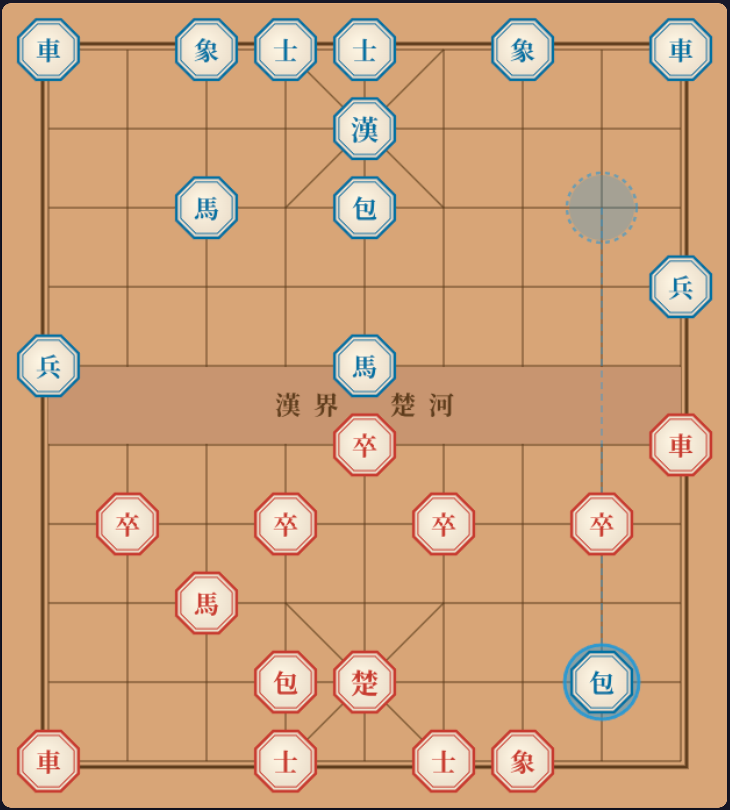

 Janggi Champion AI

Web-based Korean Chess (Janggi) AI with 5-Agent Orchestration Pipeline

Updated: October 29, 2026 | Designer: Brian Lee

## 🔬 형식 검증 (Formal Verification) — Oct.29, 2026

- **적용 표준**: WDLAB-STD-VERIFY-001 v1.0 (Unified WDLAB Proof-Skills Standard), proof-skills v0.1.1, TLA+/TLC (tla2tools v1.8.0, TLC 2026.10.28). 산출물은 [`formal/`](formal/) 에 추가(thin additive shell).
- **Concern**: `ai-move-undo-race` — 워커 스레드(`asyncio.to_thread`)에서 돌아가는 AI 수(`orchestrator.ai_move`: 턴 확인 → **원본 보드 위** 투기적 탐색 → 수 적용)와 이벤트 루프 스레드의 `undo`/`move`/추가 `ai-move` 요청이 락 없이 같은 `Game` 을 변경하는 경합.
- **Verdict**: **FIXED** (F1) + **BOUNDED-PASS (L2)** — 수정 후 모델 `MC.cfg` 경계 `AiThreads=2, MaxHuman=3, MaxAiCalls=3, MaxUndo=2` 에서 95 distinct states, depth 18, 반례 없음. 신뢰 기반: TLC 2026.10.28, 추상화 "보드 = 수 스택(H/A/S)", "탐색 = push 1회+pop 1회", undo/human_move 원자적(수정 ON 에서 락으로 실제 원자화), 사람=CHO 선수, 게임 종료 없음. 이 경계·추상화 밖(기물 합법성, 다중 게임 공유 싱글턴, 읽기 경합)은 검증되지 않았다.
- **수정된 finding F1** (수정 전 코드에서 결정적 재현 `tests/test_ai_move_undo_race.py` 3건 실패 → 수정 후 통과): AI 사고 중 `POST /undo` 가 받아들여져 `current_turn`/`move_count` 패리티가 깨지고(P1), 사람이 연속 2수를 두거나 사람 수가 보드에서 사라지고 AI 가 2수를 두며(P2), 동시 `POST /ai-move` 2건이 모두 통과해 AI 가 2수를 둔다. 수정: 게임별 `threading.Lock`(`orchestrator.py`: `human_move`/`undo_move` 비블로킹 획득 → `"AI is thinking"`, `ai_move` 는 락을 쥔 채 실행) + `Game.undo_move` 가 진행 중 게임의 AI 차례에는 `"Cannot undo while AI is thinking"` 으로 거부 + WS `game:undo` 실패를 `game:error` 로 통지. 모델에서 락만/가드만 켜면 각각 다른 트레이스로 다시 실패함을 확인(두 요소 모두 필요).
- **부수 발견(미수정, HITL)**: F2 이 호스트의 `~/.pyenv/versions/3.12.11` 인터프리터는 `asyncio.to_thread` 호출만으로 세그폴트(혼합 빌드) → `/usr/bin/python3` 사용 또는 pyenv 재설치 필요; F3 WS `game:end` 경로 `finalize_game` 2중 호출로 장기 통계 2중 집계 가능; F4 AI 탐색 중 `GET /state` 가 투기적 보드 노출; F5 3회 반복 무승부 off-by-one; F6 프론트 "무르기" 버튼이 AI 사고 중 활성; F7 이 README 의 `#` 문자가 모두 유실됨(제목·앵커·셸 주석).
- **실행**: `./formal/run_all.sh --tests` (3-config 기대값 단언: `MC`=PASS, `MC_bug`=FAIL, `MC_sanity`=FAIL + 변이 2종 + 재현 테스트). 모델: `formal/ai-move-undo-race/tla/{Spec,Properties}.tla`, 증거: `formal/ai-move-undo-race/evidence/`, 기계 판독: `formal/findings.json`.
- **보고서**: `formal/reports/2026-10-29-ai-move-undo-race.md` (사본: `~/ai_project/Proof-Skills/JangGi_ProofSkills_Report_2026-10-29.docx`).

---

 Table of Contents

1. [Overview](1-overview)
2. [Architecture](2-architecture)
3. [AI Engine](3-ai-engine)
4. [5-Agent Pipeline](4-5-agent-pipeline)
5. [Memory System](5-memory-system)
6. [Backend API](6-backend-api)
7. [Frontend](7-frontend)
8. [Project Structure](8-project-structure)
9. [Setup & Running](9-setup--running)
10. [API Reference](10-api-reference)
11. [Testing](11-testing)
12. [Configuration](12-configuration)
13. [Technical Details](13-technical-details)
14. [Recent Updates (as of 2026-10-15)](14-recent-updates-as-of-2026-10-15)

---

 1. Overview

Janggi Champion AI is a full-stack web application for playing Korean Chess (Janggi, 장기) against an AI opponent. The system features:

- A high-performance game engine with advanced search algorithms (Negamax + Alpha-Beta + PVS + Quiescence Search)
- A 5-agent AI orchestration pipeline that analyzes positions from multiple perspectives
- Real-time gameplay via WebSocket with a Canvas-based interactive board
- A 3-layer memory system (Working / Short-term / Long-term) for game context and learning

The AI reaches search depths of 6-7 plies within a 3-second time limit, processing approximately 37,000-39,000 nodes per second.



---

 2. Architecture

```
┌─────────────────────────────────────────────────────────┐
│                    Frontend (Next.js 14)                 │
│  ┌──────────┐  ┌───────────┐  ┌────────────────────┐   │
│  │ JanggiBoard│  │ LeftPanel  │  │    RightPanel       │   │
│  │ (Canvas)  │  │ (Info)    │  │ (AI Analysis)      │   │
│  └──────────┘  └───────────┘  └────────────────────┘   │
│        │              │                  │               │
│  ┌─────┴──────────────┴──────────────────┘               │
│  │     useGame (REST) + useWebSocket (WS)               │
│  └──────────────────────────────────────────────────────│
└────────────────────────┬────────────────────────────────┘
                         │ HTTP + WebSocket
┌────────────────────────┴────────────────────────────────┐
│                  Backend (FastAPI + Uvicorn)              │
│                                                          │
│  ┌──────────────────────────────────────────────────┐   │
│  │              REST API + WebSocket Handler          │   │
│  └───────────────────────┬──────────────────────────┘   │
│                          │                               │
│  ┌───────────────────────┴──────────────────────────┐   │
│  │           JanggiOrchestrator (5-Agent Pipeline)    │   │
│  │                                                    │   │
│  │  ┌─────────┐ ┌─────────┐ ┌─────────┐ ┌────────┐  │   │
│  │  │Strategy │→│UseCase  │→│Win/Loss │→│ Risk   │  │   │
│  │  │Analyst  │ │Designer │ │Analyst  │ │Assessor│  │   │
│  │  └─────────┘ └─────────┘ └─────────┘ └────────┘  │   │
│  │       ↓                                     ↓      │   │
│  │  ┌─────────┐                          ┌────────┐  │   │
│  │  │ Search  │                          │Report  │  │   │
│  │  │ Engine  │                          │Generator│  │   │
│  │  └─────────┘                          └────────┘  │   │
│  └────────────────────────────────────────────────────┘   │
│                                                          │
│  ┌──────────────────────────────────────────────────┐   │
│  │                    Game Engine                     │   │
│  │  Board + Pieces + Evaluator + Search + Game       │   │
│  └──────────────────────────────────────────────────┘   │
│                                                          │
│  ┌──────────────────────────────────────────────────┐   │
│  │              3-Layer Memory System                 │   │
│  │  Working Memory ← Short-Term ← Long-Term (JSON)  │   │
│  └──────────────────────────────────────────────────┘   │
└──────────────────────────────────────────────────────────┘
```

---

 3. AI Engine

 3.1 Board Representation

- Grid: 10 rows x 9 columns (standard Janggi board)
- Pieces: 7 types per team (King, Car/Chariot, Cannon, Horse, Elephant, Guard, Pawn) = 32 total
- Zobrist Hashing: 64-bit incremental hash for fast position identification and transposition table lookups
- Fast Attack Detection: Reverse ray scanning from king position (`_is_square_attacked`) replaces naive all-moves generation for check detection

 3.2 Search Algorithm

The search engine implements multiple advanced techniques layered together:

| Technique | Purpose |
|-----------|---------|
| Negamax | Simplified minimax framework using score negation |
| Alpha-Beta Pruning | Prunes branches that cannot affect the result |
| Principal Variation Search (PVS) | Searches first move with full window, others with zero window |
| Iterative Deepening | Searches progressively deeper (depth 1, 2, 3, ...) within time limit |
| Aspiration Windows | Narrows alpha-beta window based on previous depth's score |
| Transposition Table | Zobrist-keyed cache of evaluated positions (2M entries) |
| Null Move Pruning | Skips a turn to get quick beta cutoffs (R=2 or R=3) |
| Late Move Reductions (LMR) | Reduces search depth for unlikely-good moves |
| Check Extensions | Extends search depth by 1 when giving check |
| Killer Move Heuristic | Remembers moves that caused beta cutoffs at each depth |
| History Heuristic | Scores moves by how often they caused cutoffs in the past |
| Quiescence Search | Extends search at leaf nodes for captures and check escapes |
| Move Validation | Post-search legality check prevents any invalid move from being played |
| Repetition Detection | Returns draw score (0.0) for positions that repeat from game history |
| Opening Book | Pre-computed opening moves for the first 6 moves (중앙졸진, 마진출, 상진출, etc.) — indexed by move number, not by position hash |
| Finite Search Bounds | Alpha-beta bounds use a finite sentinel `INF = 60000` instead of `±math.inf`, so Null-Move arithmetic (`-beta + 0.01`) can never leak `inf`/`NaN` into candidate scores or API responses `(워킹트리 변경, 미커밋)` |
| Logged Fallbacks | The random-legal-move fallback in `find_best_move` and the substitution in `_validate_move` now emit warning logs instead of silently hiding search bugs `(워킹트리 변경, 미커밋)` |

 3.3 Evaluation Function

Single-pass evaluator iterates the board grid once, computing three components simultaneously:

| Component | Weight (midgame) | Description |
|-----------|-------------------|-------------|
| Material | 1.0 | Piece values with phase adjustments (Cannon value decreases in endgame, Pawn value increases) |
| Position | 0.004 | Pre-computed position score tables for each piece type |
| King Safety | 0.8 | Proximity of attacking pieces to enemy king, defensive pieces around own king |
| Mobility | 0.1 per move | `(own legal moves - enemy legal moves) * 0.1`, exposed in `evaluate_detailed()` as `mobility` plus `mobility_detail {my_moves, enemy_moves}` (previously hard-coded to 0.0) `(워킹트리 변경, 미커밋)` |
| Endgame Bonus | (endgame only) | King centralization bonus, pawn advancement bonus for deep penetration — now folded into the same single grid pass (the second full-grid scan was removed) `(워킹트리 변경, 미커밋)` |

Piece values: King=0 (infinite), Car=13, Cannon=7, Horse=5, Elephant=3, Guard=3, Pawn=2

Endgame Strategy: In the endgame phase (≤14 pieces), the evaluator adds bonuses for:
- King centralization (center column preferred for active king play)
- Advanced pawns (each row of penetration into enemy territory adds bonus)
- Cannon value decrease (fewer pieces = fewer screens for cannon jumps)
- Pawn value increase (1.5x multiplier as pawns become winning tools)

 3.4 Performance

| Time Limit | Search Depth | Nodes/sec |
|------------|-------------|-----------|
| 0.1s | 3 plies | ~39,000 |
| 0.5s | 5 plies | ~38,000 |
| 1.0s | 6 plies | ~39,000 |
| 2.0s | 6 plies | ~38,000 |
| 3.0s | 7 plies | ~37,000 |

---

 4. 5-Agent Pipeline

The AI uses a Native Sequential Orchestrator pattern with 5 specialized agents:

 Agent 1: Strategy Analyst
- Runs the core search engine to find the best move
- Evaluates board position (material, position, king safety)
- Identifies strategic patterns (opening theory, attacking, defensive)
- Generates candidate moves with scores

 Agent 2: Use Case Designer
- Classifies the current game situation (development, attack, defense, endgame)
- Selects appropriate strategy templates
- Provides tactical recommendations based on position type
- Derives the predicted win path (expected move ranges) from the actual board state (remaining material) instead of fixed turn-range strings `(워킹트리 변경, 미커밋)`

 Agent 3: Win/Loss Analyst
- Calculates win probability using sigmoid function on evaluation score
- Tracks evaluation trends across moves
- Determines if position is improving or deteriorating

 Agent 4: Risk Assessor
- Evaluates risk of each candidate move
- Checks for hanging pieces, king exposure, material loss
- Assigns risk grades (A through D)

 Agent 5: Report Generator
- Combines analysis from all agents into a unified dashboard
- Generates human-readable AI thinking summary
- Produces final game reports with phase-by-phase analysis
- `confidence` is derived from the win-path reliability and the risk score instead of fixed constants `(워킹트리 변경, 미커밋)`

 Pipeline Flow

```
Human Move → Strategy Analyst → Use Case Designer → Win/Loss Analyst
                                                          ↓
           AI Move ← Report Generator ← Risk Assessor ←──┘
```

Each agent wraps its work in a `BaseAgent.run()` method that provides timing, error handling, and structured output.

---

 5. Memory System

 Working Memory (per-turn, in-memory)
- Current board state, last move, evaluation score
- Recent 3 moves (deque)
- Immediate context for agent decisions
- `candidates` (from Strategy Analyst) and `threats` (traps detected by Risk Assessor) are now actually filled by the orchestrator every turn `(워킹트리 변경, 미커밋)`

 Short-Term Memory (per-game, in-memory)
- Complete move history with evaluations
- Phase transition records
- Positional trend analysis
- `phase_strategies` success counters recorded per phase via `record_strategy_result` `(워킹트리 변경, 미커밋)`

 Long-Term Memory (persistent, JSON files)
- Game results and statistics (wins, losses, ELO)
- Strategy patterns database — now written on game finalization (the `patterns/` directory used to stay empty) `(워킹트리 변경, 미커밋)`
- Player profiles
- Stored in `data/long_term/` directory
- Read path is live: `get_context()` feeds `persistent_opponent_profile`, the 5 most recent results and the top 10 strategy patterns back into the pipeline (previously write-only) `(워킹트리 변경, 미커밋)`

---

 6. Backend API

 Technology Stack
- Framework: FastAPI 0.115.6
- Server: Uvicorn 0.34.0
- Protocol: REST (JSON) + WebSocket
- Language: Python 3.12

 REST Endpoints

| Method | Path | Description |
|--------|------|-------------|
| GET | `/health` | Health check |
| POST | `/api/game/new` | Create new game |
| GET | `/api/game/{id}/state` | Get current game state |
| POST | `/api/game/{id}/move` | Make human move (triggers AI response) |
| POST | `/api/game/{id}/ai-move` | Run one AI move when it is the AI's turn (used right after game creation when the human plays HAN, so the AI/CHO moves first) `(워킹트리 변경, 미커밋)` |
| POST | `/api/game/{id}/valid-moves` | Get valid moves for a piece |
| GET | `/api/game/{id}/analysis` | Get AI analysis results |
| POST | `/api/game/{id}/undo` | Undo last move pair (human + AI) |
| GET | `/api/game/{id}/report` | Get/finalize game report |
| GET | `/api/stats` | Get global statistics |

All responses go through `SafeJSONResponse`, which clamps any non-finite float (`inf`/`NaN`) and logs a warning instead of failing with a 500 during serialization `(워킹트리 변경, 미커밋)`. The dev backend listens on port **8007** (`run.sh`, `backend/main.py`, Next.js dev rewrites for `/api/*` and `/ws/*`).

 WebSocket Events

| Event | Direction | Description |
|-------|-----------|-------------|
| `game:state_update` | Server -> Client | Board state after each move |
| `game:move` | Client -> Server | Human move submission |
| `game:ai_move` | Server -> Client | AI move with full analysis |
| `game:valid_moves` | Client -> Server | Request valid moves for piece |
| `game:valid_moves_response` | Server -> Client | Valid move list |
| `game:undo` | Client -> Server | Undo request |
| `game:janggun` | Server -> Client | Check notification |
| `game:error` | Server -> Client | Error notification |
| `game:end` | Server -> Client | Game over with final report |

---

 7. Frontend

 Technology Stack
- Framework: Next.js 14.2.21 (Pages Router)
- UI: React 18 + TypeScript
- Board Rendering: HTML5 Canvas API
- Charts: drawn directly with the Canvas API (unused `chart.js`/`react-chartjs-2`/`konva`/`react-konva` dependencies were removed) `(워킹트리 변경, 미커밋)`

 Components

| Component | File | Description |
|-----------|------|-------------|
| JanggiBoard | `components/JanggiBoard.tsx` | Interactive Canvas board with piece selection, move highlighting, drag support |
| LeftPanel | `components/LeftPanel.tsx` | Player info, turn indicator, agent status LED indicators (Blue=enabled, Red=disabled, Blue+pulse=running), New Game / Undo buttons. Game settings card (my side CHO/HAN, AI difficulty = search depth, time limit, CHO/HAN formation), cumulative record card from `/api/stats` (games, W/L/D, ELO, win rate, streak) and a real move list (기보) `(워킹트리 변경, 미커밋)` |
| RightPanel | `components/RightPanel.tsx` | Win probability chart, AI evaluation breakdown (now including mobility), move analysis. Game-over report card fetched from `/api/game/{id}/report` (avg depth, avg think time, total nodes, cumulative ELO); win-probability history resets when the game id changes `(워킹트리 변경, 미커밋)` |

 Hooks

| Hook | File | Description |
|------|------|-------------|
| useGame | `hooks/useGame.ts` | Game state management, REST API calls, move logic. `GameSettings` passed to `createGame()`, automatic `/ai-move` when the AI has the first move, `moveHistory`, `report`, `stats` and an `error` state surfaced as a dismissible banner (undo of one full turn = 2 plies, 400 responses shown instead of ignored) `(워킹트리 변경, 미커밋)` |
| useWebSocket | `hooks/useWebSocket.ts` | WebSocket connection, real-time event handling — connects same-origin (`window.location.host`) so the Next dev rewrite / FastAPI static serving handles routing; the former hard-coded `:8001` port is gone `(워킹트리 변경, 미커밋)` |

 Layout
Three-column layout: Left Panel (player info) | Center (game board) | Right Panel (AI analysis)

Board orientation follows the human's side, and AI move highlights use the configured AI team instead of assuming HAN `(워킹트리 변경, 미커밋)`.

---

 8. Project Structure

```
JangGi/
├── backend/
│   ├── main.py                     FastAPI entry point
│   ├── requirements.txt            Python dependencies
│   ├── api/
│   │   ├── routes.py               REST API endpoints
│   │   └── websocket_handler.py    WebSocket event handler
│   ├── agents/
│   │   ├── base_agent.py           Base agent with timing/error handling
│   │   ├── strategy_analyst.py     Agent 1: Search + strategy
│   │   ├── use_case_designer.py    Agent 2: Situation classification
│   │   ├── win_loss_analyst.py     Agent 3: Win probability
│   │   ├── risk_assessor.py        Agent 4: Move risk assessment
│   │   └── report_generator.py     Agent 5: Report generation
│   ├── engine/
│   │   ├── board.py                Board representation + move gen
│   │   ├── pieces.py               Piece types and values
│   │   ├── search.py               Search engine (Negamax + AB + PVS)
│   │   ├── evaluator.py            Position evaluation function
│   │   ├── opening_book.py         Opening book (first 6 moves)
│   │   └── game.py                 Game session management
│   ├── memory/
│   │   ├── memory_manager.py       3-layer memory coordinator
│   │   ├── working_memory.py       Per-turn memory
│   │   ├── short_term_memory.py    Per-game memory
│   │   └── long_term_memory.py     Persistent JSON storage
│   └── orchestrator/
│       └── orchestrator.py         5-agent sequential pipeline
├── frontend/
│   ├── package.json                NPM dependencies
│   ├── tsconfig.json               TypeScript config
│   ├── pages/
│   │   ├── _app.tsx                App wrapper
│   │   ├── _document.tsx           HTML document
│   │   └── index.tsx               Main game page
│   ├── components/
│   │   ├── JanggiBoard.tsx         Canvas board component
│   │   ├── LeftPanel.tsx           Player info panel
│   │   └── RightPanel.tsx          AI analysis panel
│   ├── hooks/
│   │   ├── useGame.ts              Game state hook
│   │   └── useWebSocket.ts         WebSocket hook
│   └── styles/
│       └── globals.css             Global styles
├── tests/
│   ├── test_engine.py              Engine unit tests (8 tests)
│   ├── test_orchestrator.py        Orchestrator tests (5 tests)
│   ├── test_ai_diagnostic.py       AI diagnostic + self-play tests
│   └── integration/                (uncommitted) A/B · E2E · Chaos integration tests against a running backend
│       ├── ab_test.py              Deep (depth 4 / 1.0s) vs shallow (depth 1 / 0.3s) AI-vs-AI strength test
│       ├── e2e_test.py             Full REST flow: create → valid moves → move/AI reply → undo → analysis → report → stats
│       └── chaos_test.py           Malformed input / out-of-range / concurrency injection, server must stay alive
├── reports/                        (uncommitted) FINAL_REPORT.md, GAP_LIST.md (G1–G28), raw ab/e2e/chaos result JSON
├── data/
│   └── long_term/                  Persistent game data
│       ├── games/                  Game records
│       ├── patterns/               Strategy patterns
│       └── players/                Player profiles
├── docker/
│   ├── Dockerfile.backend          Backend container
│   └── Dockerfile.frontend         Frontend container
├── docker-compose.yml              Docker orchestration
├── run.sh                          Local startup script
├── Self_test_report.md             Test report (41 tests, all pass)
└── README.md                       This file
```

---

 9. Setup & Running

 Prerequisites

- Python 3.12+
- Node.js 18+ and npm
- (Optional) Docker and Docker Compose

 Quick Start

```bash
 Clone and enter project
cd JangGi

 Run everything with one command
chmod +x run.sh
./run.sh
```

This will:
1. Install Python dependencies
2. Install Node.js dependencies
3. Start the frontend dev server on port 3005
4. Start the backend API on port 8007

 Manual Setup

Backend:
```bash
pip3 install -r backend/requirements.txt
python3 -m uvicorn backend.main:app --host 0.0.0.0 --port 8007
```

Frontend:
```bash
cd frontend
npm install
npx next dev -p 3005
```

 Docker

```bash
docker-compose up --build
```

- Backend: http://localhost:8000
- Frontend: http://localhost:3000

 Access Points

| Service | URL |
|---------|-----|
| Frontend | http://localhost:3005 (dev) or http://localhost:3000 (Docker) |
| Backend API | http://localhost:8007 (dev) or http://localhost:8000 (Docker) |
| API Documentation | http://localhost:8007/docs (Swagger UI) |

> Note: on a pyenv build of Python 3.12 `asyncio.run()` crashed with a segfault during the 2026-06-06 audit; the backend ran correctly with the system Python (`/usr/bin/python3`). Use the system interpreter if uvicorn dies on startup.

---

 10. API Reference

 Create Game

```bash
POST /api/game/new
Content-Type: application/json

{
  "cho_formation": "내상외마",     CHO formation (optional)
  "han_formation": "내상외마",     HAN formation (optional)
  "ai_team": "han",              AI plays as "han" or "cho"
  "ai_depth": 6,                 Max search depth (optional)
  "ai_time_limit": 3.0           Search time limit in seconds (optional)
}

 Response: Full game state with game_id
```

 Make Move

```bash
POST /api/game/{game_id}/move
Content-Type: application/json

{
  "from_row": 3,
  "from_col": 0,
  "to_row": 4,
  "to_col": 0
}

 Response: { human_move: {...}, ai_move: {...} }
 AI move includes search stats, evaluation, 5-agent analysis
```

 Get Valid Moves

```bash
POST /api/game/{game_id}/valid-moves
Content-Type: application/json

{ "row": 3, "col": 0 }

 Response: { "valid_moves": [[4,0], [3,1]] }
```

 Trigger AI Move (AI has the first move) `(워킹트리 변경, 미커밋)`

```bash
POST /api/game/{game_id}/ai-move
 Response: { ai_move: {...} }   404 if game not found, 400 if it is not the AI's turn
```

 WebSocket Connection

```javascript
const ws = new WebSocket(`${location.protocol === 'https:' ? 'wss' : 'ws'}://${location.host}/ws/{game_id}`); // same-origin; dev rewrite forwards to :8007

// Send move
ws.send(JSON.stringify({
  event: 'game:move',
  data: { from_row: 3, from_col: 0, to_row: 4, to_col: 0 }
}));

// Receive AI response
ws.onmessage = (event) => {
  const { event: eventType, data } = JSON.parse(event.data);
  // eventType: 'game:ai_move', 'game:state_update', etc.
};
```

---

 11. Testing

 Run All Tests

```bash
 Unit tests
python3 -m pytest tests/test_engine.py tests/test_orchestrator.py -v

 AI diagnostic tests (includes self-play)
python3 -m tests.test_ai_diagnostic
```

 Test Coverage

| Suite | Tests | Description |
|-------|-------|-------------|
| `test_engine.py` | 8 | Board, pieces, moves, evaluator, search, game, check |
| `test_orchestrator.py` | 5 | Game creation, pipeline, analysis, valid moves, stats |
| `test_ai_diagnostic.py` | 8 | Eval symmetry, search symmetry, hash, tactics, perf, move validity |
| `integration/ab_test.py` `(워킹트리 변경, 미커밋)` | 4 games | Deep vs shallow search; hypothesis "deeper search wins more" (last run: A 3W 0L 1D, NPS ~33k–37k) |
| `integration/e2e_test.py` `(워킹트리 변경, 미커밋)` | 68 | Full REST flow incl. mobility measurement, human=HAN / AI-first flow, long-game `inf` serialization regression |
| `integration/chaos_test.py` `(워킹트리 변경, 미커밋)` | 18 | Non-existent game, out-of-range coords, wrong-team piece, missing fields/broken JSON, undo at start, 50 games, concurrent requests |

 Integration Tests (backend must be running on :8007)

```bash
python3 tests/integration/ab_test.py
python3 tests/integration/e2e_test.py
python3 tests/integration/chaos_test.py
 Raw results are written to reports/{ab,e2e,chaos}_result.json
```

 Self-Test Report

See [Self_test_report.md](Self_test_report.md) for the complete test report with 41 tests covering:
- Self-play simulations (120 moves, 0 invalid moves, 0 corruptions)
- All REST API endpoints (24 tests including error cases)
- WebSocket integration
- Frontend build verification
- Framework code review

---

 12. Configuration

 Environment Variables

| Variable | Default | Description |
|----------|---------|-------------|
| `AI_DEPTH` | 6 | Maximum search depth |
| `AI_TIME_LIMIT` | 3.0 | Search time limit (seconds) |
| `STORAGE_DIR` | `./data/long_term` | Long-term memory storage path |

 Piece Values

| Piece | Korean | Hanja | Value |
|-------|--------|-------|-------|
| King | 왕 | 漢/楚 | 0 (infinite) |
| Car (Chariot) | 차 | 車 | 13 |
| Cannon | 포 | 包 | 7 |
| Horse | 마 | 馬 | 5 |
| Elephant | 상 | 象 | 3 |
| Guard | 사 | 士 | 3 |
| Pawn | 졸/병 | 卒/兵 | 2 |

 Board Coordinates

```
     0   1   2   3   4   5   6   7   8
  0  車  馬  象  士  楚  士  象  馬  車    ← CHO (row 0-4)
  1  ·   ·   ·   ·   ·   ·   ·   ·   ·
  2  ·   包  ·   ·   ·   ·   ·   包  ·
  3  卒  ·   卒  ·   卒  ·   卒  ·   卒
  4  ·   ·   ·   ·   ·   ·   ·   ·   ·
  5  ·   ·   ·   ·   ·   ·   ·   ·   ·
  6  兵  ·   兵  ·   兵  ·   兵  ·   兵
  7  ·   包  ·   ·   ·   ·   ·   包  ·
  8  ·   ·   ·   ·   ·   ·   ·   ·   ·
  9  車  馬  象  士  漢  士  象  馬  車    ← HAN (row 5-9)
```

---

 13. Technical Details

 Critical Bug Fixes (Session 3, March 2026)

1. `undo_move` Piece Swap Bug: The move history stored captured pieces as dict snapshots, causing wrong piece restoration when multiple same-type pieces were captured at the same position. Fixed by storing direct object references.

2. SearchTimeout Board Corruption: When `SearchTimeout` exception propagated through recursive search, `undo_move()` was never called. Fixed with `try/finally` around all `move_piece`/`undo_move` pairs.

3. Quiescence Infinite Recursion: The in-check branch of quiescence search had no depth limit, causing `RecursionError` during perpetual check. Fixed with depth bound.

4. `is_in_check` Performance: Replaced O(all_enemy_moves) check detection with O(ray_scan) reverse attack detection, reducing `is_in_check` from 66% of search time to <20%.

 Key Design Decisions

- Single-pass Evaluation: Material, position, and king safety computed in one grid iteration for maximum speed at leaf nodes
- `__slots__` Pieces: Piece class uses `__slots__` with cached `_value`, `_hanja` for zero-overhead property access
- Tuple Move History: Move history uses lightweight tuples `(fr, fc, tr, tc, captured_ref)` instead of dicts for search performance
- Canvas Rendering: Frontend uses HTML5 Canvas instead of React-Konva for a lighter footprint
- Sequential Pipeline: 5 agents run sequentially (not parallel) to ensure each agent has access to previous agents' results
- Agent LED Indicators: Each AI agent has a LED-style status indicator with glow effects — Red LED (disabled/error), Blue LED (enabled/success), Blue LED with pulse animation (currently running)

---

 14. Recent Updates (as of 2026-10-15)

- **2026-10-29 (formal)** — WDLAB proof-skills 형식 검증 `ai-move-undo-race`: AI 탐색 중 undo/move/2중 ai-move 경합 F1 FIXED (게임별 락 + undo 턴 가드), TLA+ 3-config + 재현 테스트 `tests/test_ai_move_undo_race.py` 추가. 상단 "형식 검증" 절 참조.
- **2026-05-31 (committed)** — Dev backend port moved to **8007** (`run.sh`, `backend/main.py`, Next dev rewrites); README ports corrected accordingly.
- **2026-06-06 (워킹트리 변경, 미커밋)** — Audit of 28 gaps (`reports/GAP_LIST.md`, 24 fixed / 4 accepted) with A/B · E2E · Chaos integration tests (`tests/integration/`, final run E2E 68/68, Chaos 18/18):
  - UI: game settings (side, difficulty, time limit, formations), cumulative record card (`/api/stats`), real move list, game-over report card (`/api/game/{id}/report`), error banner, undo = one full turn surfaced, win-probability history reset per game, AI-team-aware highlights.
  - API: new `POST /api/game/{id}/ai-move`; `SafeJSONResponse` clamps `inf`/`NaN`; WebSocket hook connects same-origin (no hard-coded port).
  - Engine: real mobility term in the evaluator, endgame pawn bonus merged into the single pass, finite search bounds (`INF = 60000`), warning logs on random/substitution fallbacks, palace-pawn diagonal branch cleanup, docstrings of `opening_book`/`websocket_handler` aligned with behaviour.
  - Agents/Memory: Use Case Designer win path derived from board state, Report Generator confidence derived from data, working `candidates`/`threats` and short-term `phase_strategies` filled, long-term `get_context()` read path (opponent profile, recent results, strategy patterns) and pattern persistence on finalize.
  - Dependencies: unused `anthropic`/`chromadb`/`redis`/`psycopg2-binary`/`numpy`/`aiohttp`/`httpx`/`python-docx`/`python-multipart`/`python-socketio` removed from `requirements.txt`; `konva`/`react-konva`/`chart.js`/`react-chartjs-2` removed from `package.json`.

---

Janggi Champion AI - Korean Chess AI System
Built with Python, FastAPI, Next.js, React, and TypeScript
